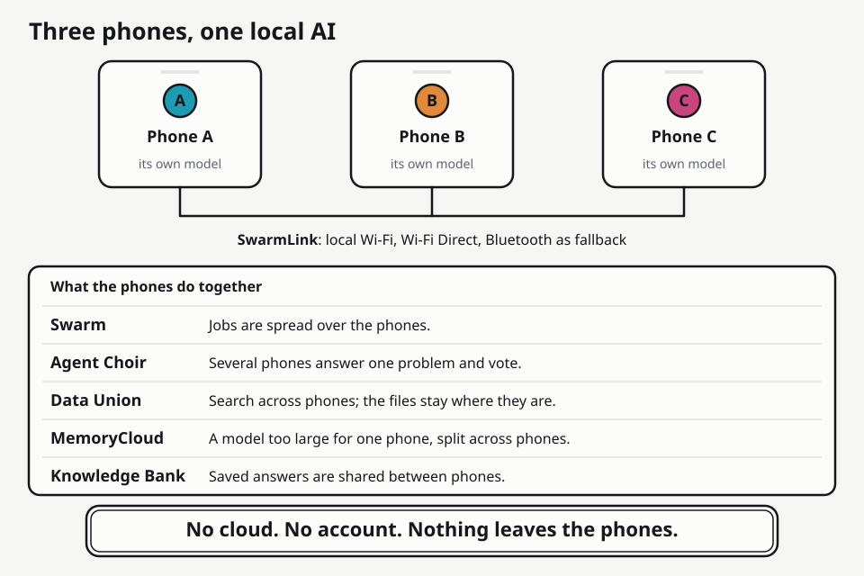
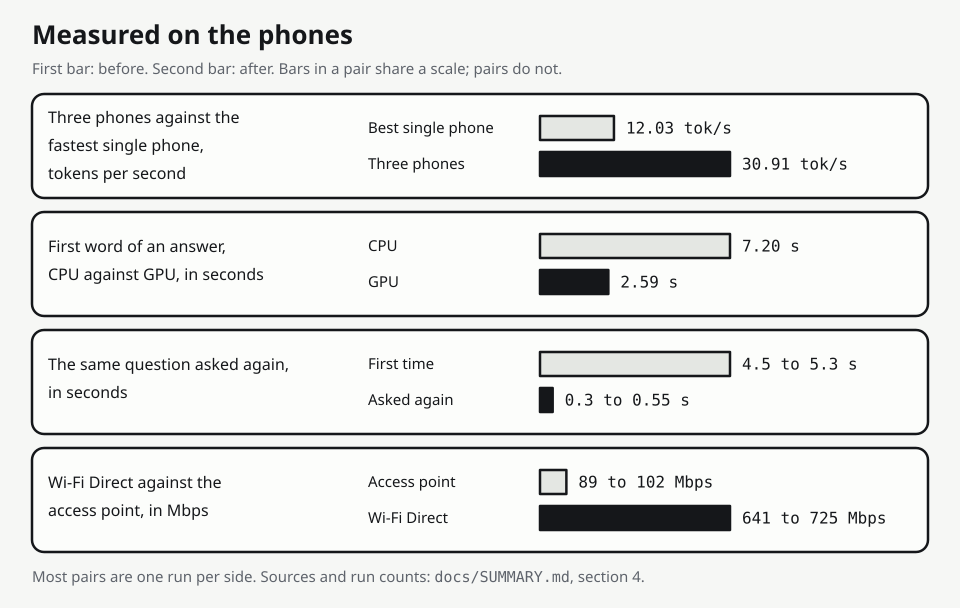
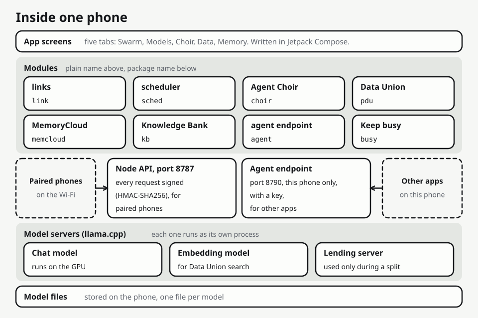
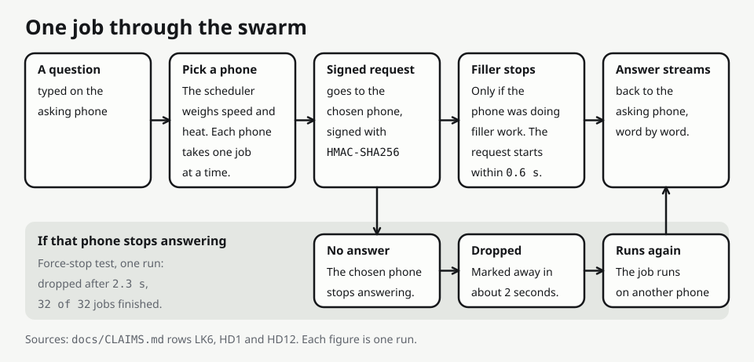

# Ustaad

Ustaad is an Android app that joins two or three nearby phones on one Wi-Fi into a small local AI cluster, with no cloud model in the loop. Each phone runs its own llama.cpp model servers, and the phones share jobs, questions about their files, and memory over a signed local link. It was built in 48 hours for the iQOO Hackathon 2026 Grand Finale (Bengaluru, 2026-10-09 to 2026-10-11) and has run only on three iQOO 15 phones (model I2501, Snapdragon 8 Elite Gen 5, 16 GB, Android 16). It is for anyone with a few recent phones who wants to see what they can do together without sending anything to a server, and for the judges who must decide whether that is true. So this page says what was measured, on what, and what was not.



Read next: [docs/ARCHITECTURE.md](docs/ARCHITECTURE.md) for how it works, [docs/CLAIMS.md](docs/CLAIMS.md) (binding) for what may be said about it, [docs/SUMMARY.md](docs/SUMMARY.md) for the whole picture, and [docs/README.md](docs/README.md) for an index of every document.

Naming. The product is Ustaad. It was called SwarmOS until 2026-10-10, and code identifiers keep the old name (package `com.swarmos.app`, deep link `swarmos://pair`, service type `_swarmos._tcp`) until a final rename step (docs/CONTRACTS.md section 10). The demo build's application id is `com.ustaad.app`.

## What it does

| Part | What it does |
|---|---|
| SwarmLink | Finds the other phones on the same Wi-Fi, pairs them by QR code, link or pasted code, and sends signed requests over Wi-Fi Direct, the access point or Bluetooth (small control messages only). |
| Swarm | Gives each job to the best free phone, one job per phone, and moves it on if a phone stops answering. A batch of short prompts runs on all phones at once. |
| Agent Choir | Every phone answers the same problem. Phones that disagree see the others' answers and revise. An answer is marked VERIFIED only if it passed the problem's own test. |
| Private Data Union | Ask in plain words; each phone searches its own photos and documents. Only the question leaves a phone, and a few short snippets with file names come back. Folders are private until the owner shares them. |
| MemoryCloud | Splits a model that is too big for one phone by layer range across phones that lend memory. It adds capacity, not speed. |
| ExpertMesh | A screen that explains the same split for a mixture-of-experts model. Whole layer ranges were placed on phones, not single experts. |
| Knowledge Bank | Saves an answer as a card, shares it with the other phones, and answers a later question that matches it from the card, with no live search and no model run. |
| Agent endpoint | Other apps on the same phone use its model through an OpenAI-format endpoint on 127.0.0.1, behind a key the owner makes. Off by default. |
| Keep busy and Hammer | An idle phone runs short filler jobs so that it is in use. Hammer keeps it at full duty even when it is warm. |

## Measured on the phones



Every number below comes from a run on the iQOO phones and is logged under docs/benchmarks/. Most rows are one run on each side, on the debug build. Several pairs come from different builds or different heat, and the full table says which.

The full table with the phones, the number of runs and the source file of each row is in [docs/SUMMARY.md](docs/SUMMARY.md) section 4. What may be said about each row is in [docs/CLAIMS.md](docs/CLAIMS.md).

| What changed | Before | After | Phones and runs |
|---|---|---|---|
| Three phones instead of the fastest one, batch of 32 short prompts, GPU | 12.03 tok/s (Phone C alone) | 30.91 tok/s, mean of 5 runs (28.90 to 31.94) | A, B and C. 2.57 times the fastest phone (2.40 to 2.65). Two phones: 18.83, one run |
| Chat on the GPU instead of the CPU, in the app | Reads prompts at 71.6 tok/s, first word 7.20 s, 5952 MB | 201.9 tok/s, 2.59 s, 1032 MB | Phone C, one run each, cool. Decode speed is about the same (16.47 and 17.31 tok/s) |
| Wi-Fi Direct instead of the access point | 89.2 to 102.2 Mbps | 640.7 to 724.9 Mbps | A and C, 200 MiB, raw. 790 to 920 Mbps with 4 to 8 streams |
| A model one phone cannot run (Qwen3-30B-A3B, 18.6 GB) | One phone: no word in 134 s, 23 apps killed. Two phones: did not load | Three phones: 5.7 to 6.4 tok/s, first word 1.5 to 2.8 s | C alone; C with A; C with A and B. One run each. Never two phones |
| Second load of that split model, cached pieces on the lenders | 319 s | 65 s | C, A and B. A re-plan with warm caches |
| Agent Choir on three phones against one phone sampling three times | 32.3 s per problem, 18 of 20 right | 20.1 s, 16 of 20 right | B coordinating, A and C. One run. Faster, not more accurate; one problem is 5 points |
| Data Union, first word of an answer, GPU instead of CPU | 12.4 s and 11.8 s | 5.8 s and 2.6 s | Two questions, one ask each, in two different runs |
| A saved card instead of a live search, author's phone stopped | 5090 ms | 35 to 47 ms | C asking, B stopped, the identical question. One run each |
| A new Knowledge Bank card reaches the other phones | Not there after 48 s | 497 to 754 ms (a revoke: 420 to 506 ms) | Second run two phones, third run three phones, no sync call |
| Refusing a model that will not fit | 134 s of swap thrashing | Refused in 0.4 s, with the numbers | Phone C, one run each |
| A phone dies in the middle of a batch | Not measured before | Dropped after 2.3 s, 32 of 32 jobs finished | One run. If the coordinating phone dies, the batch ends as interrupted and nothing resumes |
| Hammer against normal Keep busy | 46 % of the time generating, 259 filler tokens a minute | 78 % and 379, over 25 minutes | Phone A, one run. Real work decodes at 10.8 to 11.1 tok/s against 13.3; skin up to 45.0 C |

## How it works



Each phone runs one app with a foreground service. The service starts a node server on port 8787 and the llama.cpp program `llama-server` as child processes (and `rpc-server` when a phone lends memory), which the app calls over HTTP on the loopback address. There is no JNI wrapper. Chat runs on the Adreno GPU by default and falls back to the CPU. Ustaad is a coordination layer over this engine, not a new model or a new engine.

Phones talk HTTP and JSON. Each request carries a time stamp and an HMAC-SHA256 signature made with the pairing secret, the receiver accepts it within 30 s, and every answer is signed too. A request that changes state carries an id, so a resend after a lost reply runs once. Traffic is signed, not encrypted.



The scheduler gives a job to the free phone with the best score: its last measured decode speed, divided by one plus the jobs waiting there, lowered at Thermal Status 2. A phone at Thermal Status 4 or more gets nothing. While a job runs on another phone, that phone is pinged every second, and two missed pings send the job elsewhere. More in [docs/ARCHITECTURE.md](docs/ARCHITECTURE.md).

## Keep busy and Hammer

An owner can switch on Keep busy, and an idle phone then runs short filler jobs on its own model. Real work always goes first. It runs at full duty while the phone is cool, at half duty when warm, and pauses when hot, when the battery is low, or when Ustaad is not on screen (unless the phone is charging and has the battery exemption, which no phone has yet). Hammer is a second button that holds full duty on a warm phone. It is off at every start and, when stopped, the phone rests for 90 seconds. In one 25-minute run it raised the time generating from 46 % to 78 %, with real work decoding at 10.8 to 11.1 tok/s against 13.3 before and the skin up to 45.0 C. A warm phone answers slower whatever the mode. The rules, the measurements and what is not measured are in [docs/KEEP-BUSY.md](docs/KEEP-BUSY.md).

## Build and run

Needs Git Bash on Windows, JDK 17, the Android SDK with an `app/local.properties` that holds `sdk.dir`, and adb. Stack: Kotlin and Jetpack Compose, minSdk 31, target 36. The llama.cpp programs (CPU and OpenCL builds) are committed under `app/app/src/main/jniLibs/arm64-v8a/`; the NDK is needed only to rebuild them.

```
bash scripts/gradle-locked.sh "$PWD/app" :app:assembleDemo      # id com.ustaad.app, no debug routes, random secret
bash scripts/gradle-locked.sh "$PWD/app" :app:assembleDebug     # id com.swarmos.app, dev secret, debug routes
bash scripts/gradle-locked.sh "$PWD/app" :app:testDebugUnitTest
export MSYS_NO_PATHCONV=1
adb -s <phone-ip>:5555 install -r app/app/build/outputs/apk/demo/app-demo.apk
```

The models are not in the repository. Fetch them with `native/fetch-models.sh <hf-repo> <file>` and push them with adb into `/sdcard/Android/data/<package>/files/models/`: `Qwen3.5-4B-Q4_K_M.gguf` (2,740,937,888 bytes) and `embeddinggemma-300M-Q8_0.gguf` (333,590,944 bytes); the 30B file is needed only on the phone that drives a split. Names, sizes and hashes are in [docs/models.md](docs/models.md). The debug and demo builds share ports, so only one runs on a phone at a time. Install, model push and pairing steps are in [docs/BUILD.md](docs/BUILD.md) and [docs/SETUP.md](docs/SETUP.md).

## Status

As of 2026-10-11 13:45 (HANDOFF.md).

| | |
|---|---|
| Code | master b745c23. 1594 unit tests, 0 failures (docs/BUILD.md, 13:39). Not yet on a phone |
| Phones A, B and C | Build 4821aea on A and C since 07:13, 0734013 on B. With the founder since about 10:59. At 13:40 Phone B was asleep and locked, and phones A and C did not answer on the network. Nothing can be tested until the founder frees them |
| Battery exemption | Not in effect on any phone at 05:50: Ustaad is not in the system's list and Settings reads "Runs only while Ustaad is on screen". Keep busy pauses when Ustaad is not in front |
| Demo build | Builds. Installed once on Phone C for three closed-route checks with no recorded result. Not run end to end on a phone |
| Gates 0 to 5 | Closed, each with measured numbers on the real phones |
| Gate 6, polish | Open: the founder's rehearsal list, the battery exemption and QR pairing (taps only a person can do), the demo build end to end |
| Gates 7 and 8 | Closed: the agent endpoint, then tool calling and file search for other apps |
| Gate 9 | Closed for what two phones could show: audits, hardening, Keep busy |
| Final audit | Four independent readers read the code and a tester ran the regression on phones A and B before the fixes and after each round of them. No blocker. 52 findings fixed with unit tests (31 of the first pass, then 21 from a second and a third Codex pass on the fixes themselves), 24 written down with their reasons, 11 claims reworded. One fix slowed the watch for a frozen model server; the phone regression caught it and it was corrected (docs/review/2026-10-11-final-audit.md) |
| Not yet seen on a phone | The 21 fixes of the second and third Codex pass, MemoryCloud after them; the 30B split with the fixed build (the planner refuses it on two phones, so it needs Phone B); three phones together on this build; Keep busy off screen; the pause for low memory, whose condition was not produced |

The rule held throughout: a gate without measured numbers on the real phones did not close. The gate files are in [gates/](gates/); the newest is `gate-9-hardening.md`.

## Limits you should know

- The evidence is from three phones of one type, one chat model (Qwen3.5-4B, plus a 30B model for one split), on one evening and the night after. Most figures are one run, and some comparisons come from different builds or different heat; their files say which.
- The phones ran the debug build `com.swarmos.app`. The demo build has not run a Choir problem, a split, a swarm batch or a Data Union ask, and its three closed-route checks have no recorded result.
- Heat decides speed. Sustained decode on the GPU fell from 12.3 to 10.6 to 6.8 tok/s at minutes 1, 5 and 10, with Thermal Status 4 at 590 s. A 20-problem Choir run took all three phones to Thermal Status 2 or 3 in eight minutes. Demo segments stay short.
- Ustaad works while it is in front with the screen on. With the screen off Android froze the app in every test and killed it twice while it generated. The battery exemption has never been granted on a phone, so Keep busy runs only with the app on screen until it is.
- Choir is faster than one phone sampling three times and not more accurate (16 against 18 of 20). It is slower than one phone answering once (20.1 against 11.4 s).
- Data Union misses its own targets: 2 of 9 first-time questions reached the first word within 2 s and 4 of 9 finished within 6 s (medians 4.2 s and 6.6 s). One Hindi answer was partly wrong. Nobody has tapped a citation to open a file. After the last file of a shared folder is deleted its text stays in the index, so stop sharing the folder first.
- MemoryCloud adds capacity, not speed: a model that fits one phone ran at 6.86 and 6.98 tok/s split against 10.80 and 14.69 alone. The 30B result is one run on three phones; there is no repeat of the 319 s cold load and nothing beyond 40 s per answer. ExpertMesh's "remote experts" figures are estimates.
- Traffic is signed, not encrypted. In a debug build any app on the phone can replace the pairing secret with a pairing link and no tap; the demo build ignores that. The camera QR scan has never been run by a person. A pairing with a host that never answers has already replaced the old secret.
- A key holder of the agent endpoint can read everything the owner shares with the swarm, as often as it likes. No third-party Android app has called it.
- Not measured: airplane mode; bytes sent to the internet (the code calls no server except the model download, by reading it, and that download has never run on a phone); more than three phones; a Knowledge Bank phone that is away when a card is saved; the 3-minute Knowledge Bank timer; Keep busy with the screen off.
- A coordinator that dies during a batch is not taken over. A model server restart refused for heat or memory leaves no chat model until the owner loads one.

## Repository map

```
HANDOFF.md            done, in progress, next, state of the phones
docs/                 the documents; start at docs/README.md
docs/img/             the seven diagrams used in these documents
app/                  Gradle root; module :app is the Android app
native/               llama.cpp build scripts, patches, prebuilt arm64 programs, bench scripts
scripts/              adb helpers, signed API caller, end-to-end and regression checks, throughput probe
gates/                one file per gate (0 to 9): decisions, changes from the plan, open risks
plans/                dated plans
ui-kit/               export of the 21 screen designs (visual reference, not code)
models/, third_party/ gitignored (GGUF files, fetched sources)
```

App source is in `app/app/src/main/java/com/swarmos/app/`: `core/` (registry, health, audit log, signer, foreground service), `link/` (discovery, heartbeat, pairing, Wi-Fi Direct, Bluetooth, failover, request dedup, throughput probe), `llm/` (llama.cpp runtime, GPU and CPU builds, model store, benchmark), `sched/` (scheduler, batch runner, throughput panel), `choir/`, `pdu/` (Data Union), `kb/` (Knowledge Bank), `memcloud/` (split, lender, ExpertMesh explanation), `agent/` (the endpoint for other apps), `busy/` (Keep busy and Hammer), `shell/` (setup, settings), `ui/` (the "Whiteboard" kit).

## Where the evidence is

Every number shown to judges comes from a run on the iQOO phones and is logged under [docs/benchmarks/](docs/benchmarks/). The first end-to-end run (`e2e-*`) is superseded by the second (`e2e2-*`) for every figure the second covers.

| File in docs/benchmarks/ | What it holds |
|---|---|
| [2026-10-10-swarmlink-throughput.md](docs/benchmarks/2026-10-10-swarmlink-throughput.md), [2026-10-10-swarmlink-g1.md](docs/benchmarks/2026-10-10-swarmlink-g1.md) | Wi-Fi Direct on the station channel (640 to 920 Mbps), round trips, striping, failover 700 of 700, Bluetooth, re-forming the group; discovery and the screen-off soak |
| [2026-10-10-llama-cpu-baseline.md](docs/benchmarks/2026-10-10-llama-cpu-baseline.md), [2026-10-10-throughput-tuning.md](docs/benchmarks/2026-10-10-throughput-tuning.md), [2026-10-10-inapp-llm.md](docs/benchmarks/2026-10-10-inapp-llm.md) | CPU variants, GPU against CPU standalone and in the app (prefill 201.9 against 71.6 tok/s), the 10-minute sustained decode, the restart test, the `pem_freezer` kills |
| [2026-10-10-e2e2-swarm-throughput.md](docs/benchmarks/2026-10-10-e2e2-swarm-throughput.md), [2026-10-10-e2e2-choir.md](docs/benchmarks/2026-10-10-e2e2-choir.md), [2026-10-10-e2e2-data-union.md](docs/benchmarks/2026-10-10-e2e2-data-union.md), [2026-10-10-e2e2-knowledge-bank.md](docs/benchmarks/2026-10-10-e2e2-knowledge-bank.md) | The second end-to-end run on three phones |
| [2026-10-10-memorycloud-inapp.md](docs/benchmarks/2026-10-10-memorycloud-inapp.md), [2026-10-10-rpc-split-spike.md](docs/benchmarks/2026-10-10-rpc-split-spike.md) | The 4B split over two phones; the 30B model on one, two and three phones |
| [2026-10-10-knowledge-bank.md](docs/benchmarks/2026-10-10-knowledge-bank.md) | What was built, the procedure, and the third run on three phones with no sync call |
| [2026-10-10-agent-endpoint.md](docs/benchmarks/2026-10-10-agent-endpoint.md), [2026-10-10-agent-tools-files.md](docs/benchmarks/2026-10-10-agent-tools-files.md) | Gates 7 and 8: the endpoint, tool calls, file search |
| [2026-10-10-hardening-checks.md](docs/benchmarks/2026-10-10-hardening-checks.md), [2026-10-10-evening-checks.md](docs/benchmarks/2026-10-10-evening-checks.md) | Gate 9 and after: Keep busy, fault injection, a batch with a phone dying or joining, the 45-minute and two-hour soaks |
| [2026-10-10-throttle-passive.md](docs/benchmarks/2026-10-10-throttle-passive.md), [2026-10-11-hammer.md](docs/benchmarks/2026-10-11-hammer.md) | The cooling step and the duty rule not merged; Hammer for 25 minutes on Phone A |
| [2026-10-11-final-regression.md](docs/benchmarks/2026-10-11-final-regression.md), [docs/review/2026-10-11-final-audit.md](docs/review/2026-10-11-final-audit.md) | The regression on phones A and B, and the final audit with what was fixed and what was left |
| [gates/](gates/) | Decisions, changes from the plan, open risks |

## Hard facts that bound the design

- No Wi-Fi Aware service on the phones, although the framework feature list still names it. Wi-Fi Direct and a soft access point exist ([docs/device-probes/](docs/device-probes/), [2026-10-10-swarmlink-g1.md](docs/benchmarks/2026-10-10-swarmlink-g1.md)). 6 GHz is not available (country IN, [2026-10-10-swarmlink-throughput.md](docs/benchmarks/2026-10-10-swarmlink-throughput.md)).
- No NNAPI service ([docs/device-probes/](docs/device-probes/)). The app runs on the CPU and the Adreno GPU, not the NPU.
- OriginOS freezes and kills background work: keep the screen on with Ustaad in front for any demo ([2026-10-10-swarmlink-g1.md](docs/benchmarks/2026-10-10-swarmlink-g1.md), [2026-10-10-inapp-llm.md](docs/benchmarks/2026-10-10-inapp-llm.md)).
- The phones throttle within minutes. Every speed carries its thermal state ([2026-10-10-llama-cpu-baseline.md](docs/benchmarks/2026-10-10-llama-cpu-baseline.md)).
