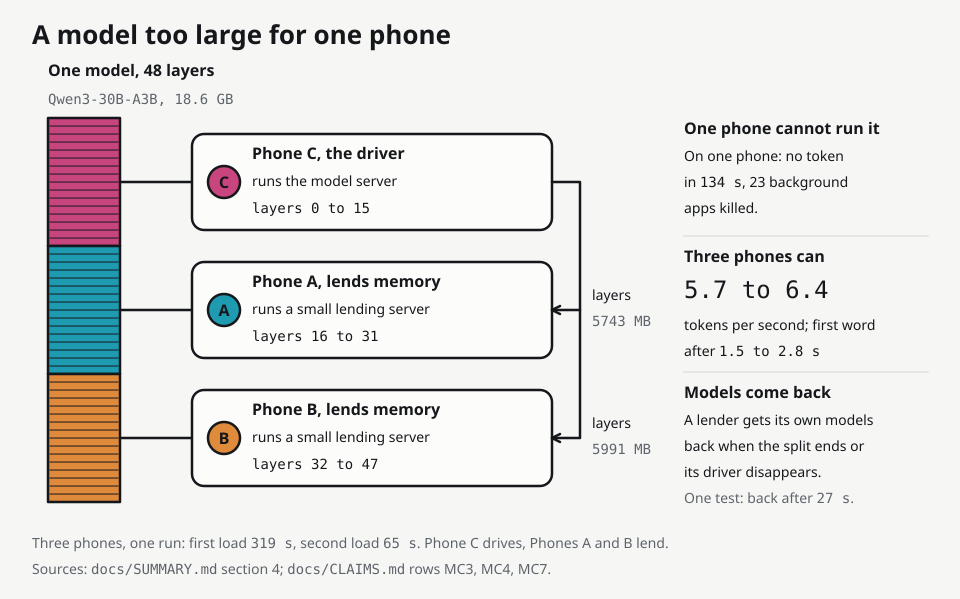

# How Ustaad is built

This page describes the parts of Ustaad and how they talk to each other. It says what the code does, as read in `app/app/src/main/java/com/swarmos/app/` at master fa8b5cd. For each behaviour it says whether it was measured on the phones or is only unit-tested. If this page and docs/CLAIMS.md disagree, docs/CLAIMS.md decides. Code identifiers still use the old name SwarmOS (package `com.swarmos.app`, deep link `swarmos://pair`).

## 1. The phone as a node

Every phone runs the same app. A foreground service (`core/SwarmService.kt`) keeps the process alive and starts four things:

- the node server, which in turn starts the link code for discovery, pairing and heartbeat;
- the model servers;
- the Keep busy loop;
- and, only when the owner switches it on, the agent endpoint.

The app has five tabs: Swarm, Models, Choir, Data and Memory.

The model servers are the llama.cpp v0.6.0 programs `llama-server` and `rpc-server`. They ship inside the APK as files named `lib*.so`, run as child processes, and the app calls them over HTTP on the loopback address. There is no JNI wrapper. Ustaad is a coordination layer over this engine. It is not a new engine or a new model.

| Role | Program | Port | What it is for |
|---|---|---|---|
| CHAT | `llama-server`, OpenCL build for the Adreno GPU by default, CPU build (i8mm) as the fallback | 8080 | Choir, Data Union answers, JSON-schema output, jobs from other phones, the agent endpoint |
| EMBED | `llama-server`, CPU build | 8081 | Turning text into 256 numbers (EmbeddingGemma-300M gives 768, cut to 256) |
| RPC | `rpc-server` | 50052 | Lending memory to a MemoryCloud driver, on demand only |

- Both `llama-server` instances start with a random key made at each app start, so another app on the phone cannot use them.
- The chat server has two slots, but the scheduler offers one job at a time per phone. Two slots gave less in total: 5.45 to 6.24 tok/s against 10.39 to 11.40 with one slot (Phone C, docs/benchmarks/2026-10-10-slots-experiment.md).
- A chat server that is part of a MemoryCloud split runs on the CPU build, because RPC together with OpenCL is unproven (`llm/LlamaArgs.kt`).

| Port | What | Who can reach it |
|---|---|---|
| 8787 | Node API, signed HTTP and JSON | Other phones (all interfaces) |
| 8788 | Raw TCP throughput probe | Other phones |
| 8790 | Agent endpoint, OpenAI format | This phone only (127.0.0.1), off until the owner turns it on |
| 8080, 8081 | Chat and embedding servers | This phone only, key required |
| 50052 | `rpc-server` | The link address only, while lending memory |

`-PportOffset=N` shifts 8787, 8788 and 8790. The debug and demo builds use the same ports, so only one of them runs on a phone at a time (docs/BUILD.md).

Models live in `/sdcard/Android/data/<package>/files/models/` and are pushed with adb:

- Qwen3.5-4B Q4_K_M for chat and all JSON output;
- EmbeddingGemma-300M Q8_0 for embeddings;
- Qwen3-30B-A3B-Instruct-2507 Q4_K_M, only on the phone that drives a MemoryCloud split.

Sizes and SHA-256 are in docs/models.md. The in-app download exists and has not run on a phone. Each phone also keeps its own SQLite index (Data Union), its saved-answer cards (Knowledge Bank) and a hash-chained audit log that is local and unsigned.

## 2. Links and pairing

Phones find each other in two ways.

- **Same Wi-Fi.** Network service discovery (`_swarmos._tcp`) plus a signed health check. With the development secret, all three phones listed each other 3.7 to 5.3 s after a cold start (docs/CLAIMS.md LK1).
- **Wi-Fi Direct.** For bulk traffic the app makes a group on 5 GHz, pinned to the access point's channel. Other phones join it by name and passphrase with no dialog. It measured 640.7 to 724.9 Mbps raw against 89.2 to 102.2 Mbps through the access point (A and C, 200 MiB, docs/benchmarks/2026-10-10-swarmlink-throughput.md).

Bluetooth carries small signed control messages only. Path choice is by measurement, and bulk traffic uses the best single path. Using Wi-Fi and Wi-Fi Direct together was slower, 0.3 to 0.5 times Direct alone.

### Pairing

- One swarm has one pairing secret: 32 random bytes written as 64 hex characters. The host phone makes it. Hosting again makes a new one, and phones that did not scan the new code drop out.
- The pairing payload holds the host's name, node id, addresses, port, the secret and, for Wi-Fi Direct, the group name and passphrase. It is shown as a QR code and as a link `swarmos://pair?d=<base64url of the JSON>`. The Join page also accepts a pasted link.
- The short pairing code a person reads aloud is not the secret. It is the first 8 hex characters of the SHA-256 of the secret, in two groups of four.
- The joining phone shows that code and adopts the secret only after its owner confirms. The check was made on the pending-pairing field. No person has tapped that dialog.
- A debug build uses a fixed development secret. The demo build makes a random one per install.
- If the host does not answer, the app keeps trying for 10 minutes and then asks to scan again. A pairing with a host that never answers has already replaced the old secret, and nothing puts it back. The final audit left that open.
- The camera QR scan has never been run by a person.

### The signed node API

Every route under `/v1` except `GET /v1/hello` needs three headers, checked in `link/NodeServer.kt`.

| Header | Content |
|---|---|
| `X-Swarm-Node` | The sender's node id. It is sent, not signed |
| `X-Swarm-Ts` | The sender's clock in milliseconds. Accepted within 30 s either side |
| `X-Swarm-Sig` | Hex HMAC-SHA256, keyed with the pairing secret, over `METHOD`, the request URI as sent (query string included), the time stamp and the exact body, joined by newlines |

The server checks, in this order:

1. the headers are present;
2. there is no chunked body (411);
3. the body is at most 1 MiB (413);
4. the time is inside the window (401, with the server's time in the answer so the caller can see the clock gap);
5. the signature matches, compared in constant time (401).

A verified request also counts as a heartbeat from that phone.

### The request id

- A request that changes state (POST, PUT, PATCH or DELETE) must carry `X-Swarm-Req`, or it gets 400.
- The server stores the answer under `node id / request id` for 5 minutes after the request finishes, at most 256 answers and 32 MB.
- If the same id arrives again, the server waits for the first run, up to 30 s. It then sends the stored answer with `X-Swarm-Replay: 1` and does not run the handler a second time. After 30 s of waiting it answers 409.
- A handler that failed is forgotten, so a retry can run. Streamed answers cannot be stored and are forgotten.
- This is what makes a resend over another path safe (`link/Dedup.kt`, `link/Failover.kt`). The request goes out on the next path with the same id. An HTTP answer, whatever its status, is final and is not retried on another path.

### Signed answers

Every answer carries `X-Swarm-Rsp`, an HMAC over the status, the request id and the body. A stranger on the Wi-Fi that merely answers 200 is not taken for a peer, and a recorded answer cannot be replayed for another request. A streamed answer carries the MAC in its last event (`link/ResponseAuth.kt`).

### What this does not do

- Traffic is signed, not encrypted. A sniffer on a shared Wi-Fi can read questions and snippets. On the app's own Wi-Fi Direct group the group key protects the radio link; that was not measured.
- The node id is not part of the signature. Inside the 30 second window a captured request would verify again. One that changes state is answered from the stored answer rather than run twice.
- The final audit left a versioned signature undone, because a change would have to reach all three phones at once.
- In a debug build any app on the phone can send a pairing link with the confirm flag and replace the secret with no tap. The demo build ignores the flag.
- Checks that passed on Phone C: wrong secret 401, 90 s clock skew 401, 2 MiB body 413. On three phones 332 answers were all valid (docs/CLAIMS.md LK10).

### Heartbeat

Once a second, with a 2.5 s timeout. Three misses in a row mark a phone away, and an away phone is probed every 5 s. A force-stopped peer was marked away in 2.1 to 2.2 s and was back 1.0 s after restart (older build, A and C).

## 3. The scheduler

One job goes through these steps (`sched/SwarmLlm.kt`).

1. The caller hands a chat request to `SwarmLlm` with a job id. The caller can be a screen, Choir, Data Union, a batch, or another app using the model name `ustaad-swarm`.
2. `SwarmLlm` refreshes each phone's capability report if it is older than 2 s: model name, free slots, last decode speed, thermal status, battery.
3. It picks the phone with the best score and a free slot (rules below).
4. A job for this phone runs in place. A job for another phone is sent as a signed `POST /v1/sched/chat` with its request id, over the best path, and the signature of the answer is checked.
5. On the other phone the node server checks the signature and the request id. `SchedNode` refuses a job from another phone at Thermal Status 4 or more, or when there is no free slot (429). `JobExecutor` runs a job id once, shares the running job with a repeat of the same id, and keeps the result for 10 minutes.
6. While a job runs on another phone, that phone is pinged every second. Two missed pings in a row abort the job there and it moves on. Silence on one job alone is not a verdict. Only pings decide.
7. If a reply is lost or times out, the same job id is sent once more to that phone if it still answers pings, and then to the next best phone. A phone that finished keeps its result, so nothing runs twice on it. A reply lost after a phone finished can make a different phone run the job again, and its answer may differ.

**How a phone is chosen.**

- Score is the last measured decode speed, divided by 1 plus the jobs queued there, times 0.8 at Thermal Status 2.
- A phone with no model server, with another model than the one asked for, or at Thermal Status 4 or more scores nothing.
- A phone that is too hot (status 3 or more), or under 15 % battery and not charging, is used last. A phone at status 3 takes a job only when no cooler phone is up.
- A phone that has not decoded yet is assumed to run at 5 tok/s, so that it is tried.
- This phone wins a tie.

**Time.** One attempt gets 30 s plus 200 ms for every token the request may generate (`sched/GenBudget.kt`), a deliberately low rate. The whole call, including the wait for a free phone, gives up after twice that. A stream that has already delivered text is not restarted on another phone.

**One slot per phone.** `JobExecutor` admits one real job at a time. Keep busy filler may borrow a free slot only while no real work runs or waits. The first real caller tells the filler to stop. A job from another phone waits at most 3 s for the slot and is then refused as it was before filler existed. Filler is not counted in the capability report.

**Batches.** `BatchRunner` pushes a list of requests through `SwarmLlm` with one worker per free slot on the phones that are up.

- It counts the slots again every second, so a phone that becomes ready mid-batch gets workers and a phone that goes away leaves none idle.
- Every item has the job id `<batch id>-<index>` and is sent with the prompt cache off.
- A request that no phone could answer is reported with its error and does not stop the batch.
- One batch runs at a time (409 for a second). The built-in set `bench32` is 32 short prompts of at most 48 tokens.
- If the coordinating phone dies, the report is marked `interrupted`, the next batch can start at once, and nothing resumes. "Stop Ustaad" on the coordinating phone ends its batches the same way: on Phone A, with 2 of 96 jobs done, Phone B's count of running jobs was 0 at the first read 4.7 s after the tap (docs/benchmarks/2026-10-11-final-regression.md, fourth pass, one run).

## 4. The modules

Each module is a plug-in with a route table, mounted under `/v1/<module id>/` on the node server: `link`, `models`, `choir`, `pdu`, `kb`, `memcloud`, `sched` (`AppGraph.kt`). What leaves a phone is described per module.

### Agent Choir

`choir/`. Peer routes `solve`, `revise` and `judge`. The run starts on the phone whose tab is used.

- Every phone answers the same problem with its own prompt and temperature (0.3 and 0.6) on the same model. Answers are typed (a number, an option letter or a short output), validated and retried once.
- Phones that disagree see the others' answers and revise, in round 2 and, if needed, round 3. A majority wins, and a judge pass runs if there is none. The deadline is 60 s.
- A Kotlin checker recomputes the arithmetic the models wrote. An answer is marked VERIFIED only if it passed the problem's own test, otherwise at best CONSISTENT.
- An equal-compute baseline, one phone sampling three times, sits beside it on screen. Choir is faster than that baseline and not more accurate.

### Private Data Union

`pdu/`. Peer routes `query` and `open`.

- Each phone keeps an SQLite index of its own photos (on-device text recognition, Hindi included), text files, PDFs and DOCX files. It has FTS5 text search and 256-number vectors compared by brute-force cosine and merged by rank, with a floor of 0.40 for a vector match.
- An ask embeds the question, searches locally, and sends the question text to the online paired phones.
- Each peer answers under its own rule: at most 5 snippets by default (1 to 10 accepted) of at most 400 characters, with the file name and no file bytes. A new folder is private until the owner shares it, and a folder named Private is never shared. The peer returns only a count of what it withheld.
- The asking phone's model writes the answer from the snippets.
- A citation tap asks the owning phone to raise a notification that its owner taps to open the file. No person has tried that.
- Files, embeddings and the index stay on the phone. After the last file of a shared folder is deleted, its text stays in the index and is still served to paired phones, so stop sharing the folder first (left open by the audit).

### Knowledge Bank

`kb/`. Routes `offer` and `cards`.

- A card is a saved answer of at most 600 characters with up to 8 sources, an id that is the hash of its content, and an HMAC. Cards are private by default. A card with a source in a private folder cannot be shared (409).
- A shared card is offered to every online peer at once when it is saved or revoked, and again every 3 minutes. A revoke is a tombstone that travels the same way.
- When a question matches a saved card closely enough (cosine 0.60, coverage 0.50), the answer comes from the card with no model run and no peer asked. It shows who saved it, when, and the sources.
- A tampered card is refused. Cards are sealed on disk with a key made from the pairing secret. If a new secret is adopted and the app is killed before they are re-sealed, they are unreadable (left open).

### MemoryCloud and ExpertMesh

`memcloud/`.

MemoryCloud runs a model that does not fit one phone as a split by layer range over llama.cpp's RPC backend. The phone that starts it is the driver.

1. `SplitPlanner` gives each phone a range of layers (equal by default, by free memory, or counts set by the caller). It counts the file plus 1536 MB per phone.
2. For each other phone, called a lender, the driver sends `POST /v1/memcloud/rpc/start`. The lender checks that the address to bind is the link address (never 0.0.0.0 or loopback) and checks its free memory.
3. The lender stops its own chat and embedding servers after recording what to restore, starts `rpc-server` with a tensor cache, and opens a lease.
4. The driver renews the lease every few seconds. The lender ends the loan 10 s after the last renewal and restores its own servers. Each loan has a token, so a stop that carries an old token gets 409.
5. The driver starts `llama-server` with `--rpc` pointing at the lenders.

The phases are `IDLE`, `PLANNING`, `STARTING_PEERS`, `LOADING`, `READY`, `DEGRADED`, `FAILED` and `BASELINE`.

It is a capacity tool, not a speed tool. A 4B model that fits one phone ran at 6.86 and 6.98 tok/s split against 10.80 and 14.69 alone. The 18.6 GB Qwen3-30B-A3B gave no token on one phone in 134 s and did not load on two. It ran across three phones in one run at 5.7 to 6.4 tok/s.

ExpertMesh is an explanation screen over the same split applied to a mixture-of-experts model (48 layers, 128 experts, 8 used per token). Whole layer ranges were placed on phones. Individual experts were not, and the screen's "remote experts" figures are arithmetic estimates.

## 5. Keep busy

- When the owner switches it on, an idle phone runs short filler jobs on its own model. They never go to another phone, and real work cancels them the moment it arrives.
- `busy/BusyPolicy.kt` holds the rules, with no clock and no phone in them. The loop runs inside the foreground service.
- Hammer, a second switch, keeps filler at full duty on a warm phone. Rules and measurements are in docs/KEEP-BUSY.md.

## 6. The agent endpoint

`agent/AgentServer.kt` is a second Ktor listener on `127.0.0.1:8790` for other apps on the same phone.

- It is off until the owner switches it on in Settings, which makes a 32-byte key. Switching it off closes the port and forgets the key.
- It speaks the OpenAI format. `GET /v1/models` lists `ustaad-local` (this phone's chat model, one call at a time) and `ustaad-swarm` (the best free phone, so the prompt travels to paired phones). `POST /v1/chat/completions` supports streaming, `json_schema` and tool calling, where the calling app runs the tools. `POST /v1/embeddings` gives embeddings.
- `POST /v1/files/search` sits behind a second switch. It returns only what a paired phone would get, so files in private folders never appear.
- Every route asks for the key first. Other source addresses and unexpected Host headers are refused. The audit log keeps counts and never text.
- It was measured on one phone with a script and the unmodified OpenAI Python client. No third-party Android app has called it. Full reference: docs/AGENT-API.md.

## 7. Failure handling

"Measured" means run on a phone. "Unit-tested only" means no phone run is recorded. Sources: docs/CLAIMS.md, docs/review/2026-10-11-final-audit.md, docs/benchmarks/.

| What fails | What the app does | Where it was seen, and what is left open |
|---|---|---|
| A phone leaves or freezes | Heartbeat once a second. Three misses mark it away. Any verified request counts as a beat. A job on that phone moves on after two missed pings | Force-stopped peer marked away in 2.1 to 2.2 s (older build) and dropped from a batch after 2.3 s (final build). The 2.5 s timeout against a real network stall: unit-tested only |
| A reply is lost or a path fails | Same request id on the next path. The same phone first if it still answers pings, then the next phone | 700 sent, 700 ok, 700 executed once, 2 path failovers. Paths were silenced with a fault hook, not by switching Wi-Fi off |
| A stream breaks after text was sent | The error is passed on. The stream is not restarted elsewhere | Unit-tested only |
| The coordinating phone dies during a batch | The report is marked `interrupted`. The next batch starts at once. Nothing resumes | Measured once: 7 of 32 jobs had finished, the rest never ran, one finished job was missing from the report |
| A phone joins or dies during a batch | Workers follow the phones that are up | Peer killed: 32 of 32 jobs still finished. Peer joined: it took 10 of 32 jobs once its model was loaded. One run each |
| The model server dies, freezes or is cut mid-answer | Restarts by itself. Twice in two minutes it runs on the CPU build with a notice. Three missed pings in 30 s counts as frozen. A stream that ends before its done marker is an error | READY again after 15.9 and 17.4 s. GPU restored in 13.7 s. Open: a restart refused for heat or memory right after a death leaves no chat model until the owner loads one |
| A model will not fit | Refused before anything is stopped, unless the file size times 1.2 plus 1.5 GB is free | Refused in 0.4 s with the numbers. Open: the check reads free memory and reserves none, so the chat and embedding models are checked against the same figure |
| A phone is too hot | Routing prefers cooler phones (section 3). Benchmarks and evaluations refuse to start. A phone refuses jobs from others at Thermal Status 4 or more. Keep busy pauses at 3 or more | Keep busy pause seen on Phone A under Hammer (seven pauses of 31 to 51 s). The refusal at status 4 is unit-tested only |
| A lender disappears mid-split | `DEGRADED` names the phone and keeps the tokens. Re-plan reloads on the phones left. After two minutes without a re-plan this phone takes its models back and stops counting as in use | `DEGRADED` after 1.2 s (4B) and 1.77 s (30B). Re-plan ready after 12.0 s and 65.3 s. The automatic release: unit-tested only |
| The driver dies mid-split | The lender's lease ends 10 s after the last renewal and it restarts its own models. It now waits up to 5 s for `rpc-server` to exit first | A lender had its models back 26 and 27 s after its driver was killed. The 10 s was not timed alone. The wait is unit-tested. The 30B split on three phones has not been run since |
| A stale or repeated stop of a loan | Each loan has a token. An old token gets 409. A retried release keeps its token | Stale stop 409, a request for 999999 MB 400, a bad layer split 400 (measured). Token on retry: unit-tested only |
| The Wi-Fi Direct group is removed | Re-formed from stored credentials | 2.2 s, or 4.2 s with a new passphrase (A and C) |
| A Data Union peer does not answer | The ask is flagged `incomplete` and names the phone. Every ask has a deadline and a Stop button. Any other error ends the ask with a note | Flag seen in one run each in the second run and the final-build smoke. In the second run the answer text did not say a phone was missing. The generic error path: unit-tested only |
| A folder is made private | One database transaction, with a repair at start | Private again 0.18 s after a kill (the kill came after the call returned) |
| The screen goes off or Ustaad leaves the front | Android freezes the app. Ustaad works with the screen on and Ustaad in front | Killed twice while generating, at 6 min 18 s and 11 min 2 s. The battery exemption has never been granted or tested on a phone |
| Keep busy gets stuck | A refused MemoryCloud start no longer counts as work in progress. A filler job over 60 s is cancelled and counted failed. A job cancelled as it was accepted no longer loses the phone's slot | The first fix checked on Phone C (22 filler jobs in the next 60 s). The other two: unit-tested only |
| Pairing with a host that never answers | Keeps trying for 10 minutes, then asks to scan again | Open: the old secret has already been replaced and nothing puts it back |

The final audit also wrote down 32 findings it did not fix, each with its reason (docs/review/2026-10-11-final-audit.md). Not handled: a coordinator that dies mid-batch is not taken over, and the app is killed with the screen off.
