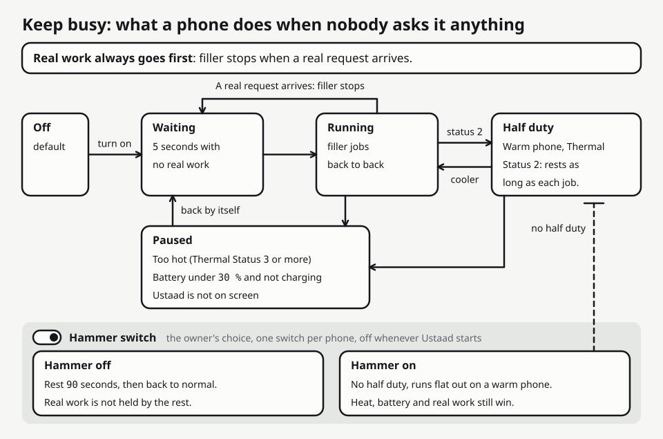
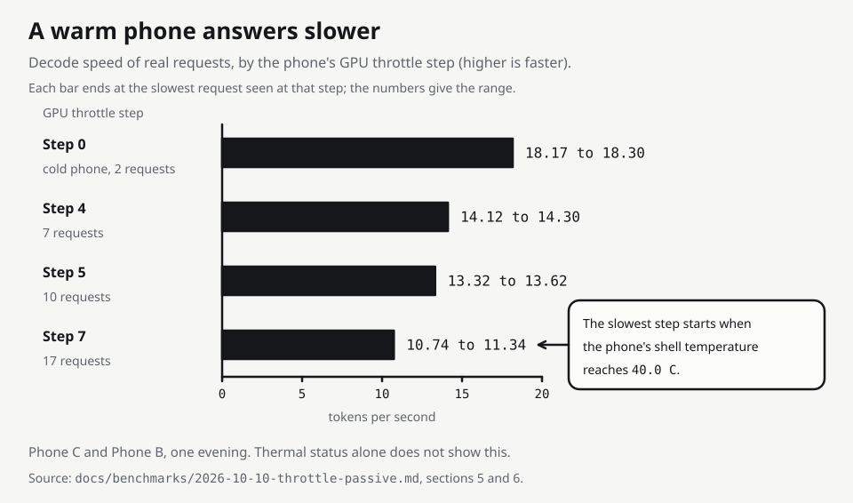

# Keep busy and Hammer: a guide for the owner of a phone

This page is for the person who holds a phone running Ustaad. It says what the Keep busy mode does, how to turn it on and off, what the Hammer button adds, and what it costs the phone. Every figure comes from a run on the iQOO phones and is followed by its file. Rules are in `app/app/src/main/java/com/swarmos/app/busy/BusyPolicy.kt`.

## What it is for

A phone that has loaded its model but has nothing to do is idle. Keep busy makes it run short filler jobs on its own model so that it is in use. A filler job is a benchmark or Choir prompt with the instruction "Answer in one short sentence.", at temperature 0, cut at 48 tokens, and the reply is thrown away. Filler runs only on the phone's own model: it is never sent to another phone and is never counted in a benchmark or scoreboard figure. It was added in gate 9 at the founder's request, and the rest of this page is about what it costs.

## The switch and where it is

- **Keep busy** is a switch in Settings, off by default. Tap the phone's name on the status strip and Settings opens.
- **Hammer** is a second switch under it, shown as two buttons that do the same thing: the first item of the Settings page and the last item, above "Save changes". It reads "Hammer: maximum usage" when off and "Hammer is on. Tap to stop." when on.
- Turning Hammer on turns Keep busy on. Turning Keep busy off turns Hammer off.
- Hammer is per phone and is not stored. It is off every time Ustaad starts, and "Stop Ustaad" switches it off.
- Under the Keep busy switch, Settings says whether the mode can run with the screen off, and "Allow with the screen off" opens Android's battery-exemption dialog (seen on Phone C; the dialog round trip was not exercised).

## The rules in plain words

The loop checks these in order, and the first that applies decides.

1. The switch must be on and a real chat model must be ready. After a chat server starts, filler waits 2 minutes; after the server died under filler, 5 minutes.
2. Ustaad must be in front. In the background the loop runs only while the phone is charging and the battery exemption is granted. Otherwise it pauses within 20 s and carries on when the app is back (Phone C).
3. Real work comes first. Filler starts only after 5 seconds without real model work, and a real request cancels the filler job in flight. A real request waits at most 3 s for the slot.
4. After Hammer is switched off the phone rests for 90 seconds, then normal rules apply. Real work is not held by the rest.
5. At Thermal Status 3 or more the loop pauses and looks again every 10 s; it carries on by itself when the status is under 3.
6. Under 30 % battery and not charging, it pauses. An unknown battery level does not pause it.
7. Under 1024 MB of free memory it pauses and looks again every 10 s, with Hammer on as well. An unknown reading does not pause it. (Added on 2026-10-11. In the regression of that build phones A and B had 4716 to 5245 MB free under Keep busy, so this pause has not been seen on a phone.)
8. At Thermal Status 2 (warm) it runs at half duty: after each job it rests as long as the job took. Otherwise it runs at full duty. With Hammer on, step 8 is skipped, so a warm phone stays at full duty. Every other rule still applies.

A filler job that has not finished after 60 s is cancelled and counted as failed, and the loop then waits 45 s before the next one, so that the watch for a frozen model server can count its three missed pings (with the server frozen on Phone A it was killed and restarted after 85.5 s).

## How much it generates

| Run | Phone | Share of time generating | Failed jobs | Source |
|---|---|---|---|---|
| 16 minutes, charging, app in front | B | 63 % (600 of 953 s) | 0 | docs/benchmarks/2026-10-10-hardening-checks.md section 1 |
| 16 minutes, same | C | 84 % (796 of 952 s) | 0 | same |
| 45 minutes, Thermal Status 2 for 41.5 and 35.0 minutes | B, C | 49.0 % and 57.8 % | 0 | docs/benchmarks/2026-10-10-evening-checks.md section 2 |
| Two hours, app on screen | B, C | about half | 0 | same file, section 9 |
| 3 hours 39 minutes, charging, app on screen, final build | A | 61 % (8072 of 13152 s), 3002 jobs | 0 | docs/benchmarks/2026-10-11-final-regression.md, last section |
| Same watch | C | 58 % (7565 of 13142 s), 2843 jobs | 0 | same |

In the 16-minute run it generated 99.5 % of the time at Thermal Status 0 or 1 and about half (49 to 51 %) at 2. So over a long run the share is about half. The time a real request spent outside the model was 0.07 to 0.59 s with filler running (6 requests, final build) against 0.04 to 0.13 s with the mode off, and 9 of 9 real requests were answered. With the screen off a phone does nothing: Phone C ran no filler and answered no other phone for 61 minutes until it was woken, and then resumed by itself.

## Hammer

Hammer is the owner's way to say "use the phone more, even when it is warm". One run on Phone A, 25 minutes, charging, Ustaad in front, one real 48-token request every five minutes (docs/benchmarks/2026-10-11-hammer.md):

| | Normal Keep busy, the two minutes before | Hammer, 25 minutes |
|---|---|---|
| Share of time generating filler | 46 % | 78 % |
| Filler tokens per minute | 259 | 379 |
| Filler jobs | 24, 0 failed | 437, 0 failed |
| Thermal Status | 2 | 2 in 79 % of samples, 3 in 21 %, never 4 |
| Skin temperature | 42.3 to 42.5 C | up to 45.0 C |
| Battery temperature | 39.5 to 39.6 C | up to 42.0 C |
| Real requests, decode | 13.3 tok/s (one request) | 10.8 to 11.1 tok/s (five requests) |

- What it buys: about 46 % more filler tokens a minute than normal Keep busy, and a share of time near 80 % where normal holds about half.
- What it costs: real work at the slow level (10.9 tok/s against 13.3 before) and a hotter phone, 45 C on the skin and 42 C in the battery.
- The pause for heat works on a phone. Thermal Status 3 was reached 6.4 minutes after switching on and then about every two and three quarter minutes. Each time the loop paused for 31 to 51 s (seven pauses) and carried on by itself. Real requests sent during a pause were answered at the same speed. Status 4 was not reached.
- After switching off, no filler ran for the 90 s of rest. In those 90 s the shell fell from 41.7 to 40.0 C and the skin from 44.7 to 42.3 C. The phone was still in the slow level afterwards: 90 seconds are not enough to leave it.

## A warm phone answers slower

The thermal report of the phone shows a cooling step for the GPU (`gpu`, with the two CPU clusters beside it). Real requests decoded at a speed that follows this step, not the Thermal Status (docs/benchmarks/2026-10-10-throttle-passive.md section 5, one watch of Phones B and C):

| Phone | Thermal Status | Step (gpu / cpu-cluster0 / cpu-cluster1) | Real requests | Decode, tok/s |
|---|---|---|---|---|
| C | 0 | 0 / 6 / 12 | 2 | 18.17 and 18.30 |
| C | 0 | 4 / 7 / 14 | 7 | 14.12 to 14.30 |
| C | 1 | 5 / 10 / 15 | 8 | 13.32 to 13.62 |
| C | 2 | 5 / 10 / 15 | 2 | 13.32 and 13.44 |
| C | 2 | 7 / 13 / 17 | 4 | 10.74 to 11.34 |
| B | 2 | 7 / 13 / 17 | 13 | 10.79 to 10.99 |

- The same phone at the same Thermal Status 2 decoded at 13.3 to 13.4 tok/s at step 5 and at 10.7 to 11.3 at step 7. Filler follows the step too: about 9.7 tok/s at step 5 against about 7.5 to 8.0 at step 7, at the same half duty.
- A cold phone is faster again (18.2 to 18.3 tok/s at step 0) but does not stay cold under work: four minutes of real requests and filler took Phone C from 33.6 to 42.6 C skin temperature and from step 0 to step 5.
- In a later watch, three times a phone moved up to step 7 as the kernel thermal zone `tz_shell` reached 40.0 C (section 6 of the same file). That is three events on two phones, not a proof. Replacing the app (an install) reset the step from 7 to 5 on both phones, so the step is not a plain function of any temperature. Phone B never left step 7 in 73 minutes although its skin and battery temperatures fell below where Phone C left it. This is not explained.

## The trade the founder chose

Usage over speed. A duty rule that reads the step was tried and not merged. Phone B ran it for 50 minutes against Phone C on the normal build (docs/benchmarks/2026-10-10-throttle-passive.md section 7, one run): real decode had a median of 13.5 tok/s against 10.8, but the share of time generating filler was 36.4 % against 56.3 % and filler tokens a minute were 214 against 284. On the night of 2026-10-10 the founder decided that the app should not trade usage for speed by itself and that the owner sets the level of usage with the Hammer button. The rule stays on a branch (e2452fe).

## What is not measured

- Battery use. The battery exemption was never granted on a phone, so whether Keep busy survives with the screen off is unknown.
- Hammer for longer than 25 minutes, on battery, or on a phone that is not charging at 100 %. Thermal Status 4 under Keep busy or Hammer: no run that was watched reached it. Phone A was found at status 4 once, at 05:32 on 2026-10-11, with nothing recording the time before; in the 3 hour 39 minute watch after it, Phone A was at status 3 in 71 of 1276 samples (Keep busy paused each time and carried on by itself) and never at 4. The Hammer buttons on Phone C and with a finger.
- How long a phone needs after Hammer to leave the slow step, and why an install resets it.
- After a pause for heat the loop resumes at the first reading under status 3 with no settling time; with Hammer it could move back and forth on that edge (docs/review/2026-10-11-final-audit.md, R11). The pause under 1024 MB of free memory (rule 7) is held by unit tests only.
- A benchmark started while a filler job runs can overlap it for up to a quarter of a second. Switch Keep busy off before a benchmark whose figure will be quoted, and before a timed demo run.
- The mode on the demo build. All of the above was measured on the debug build.
